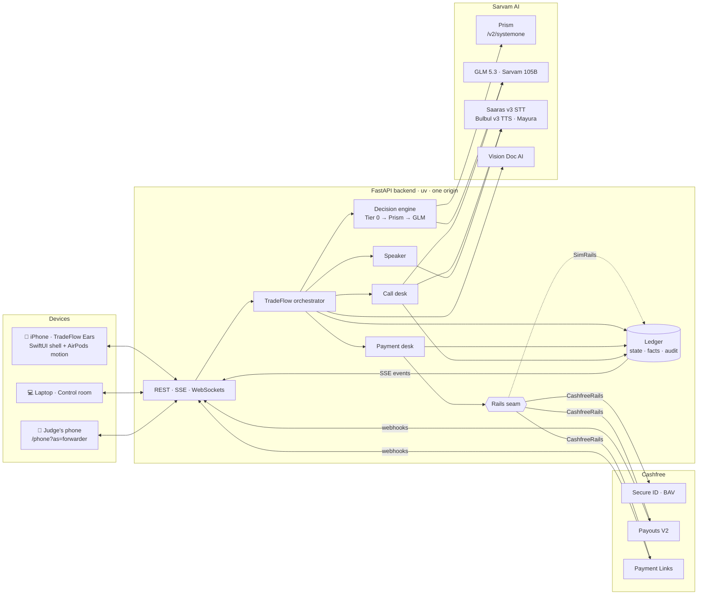
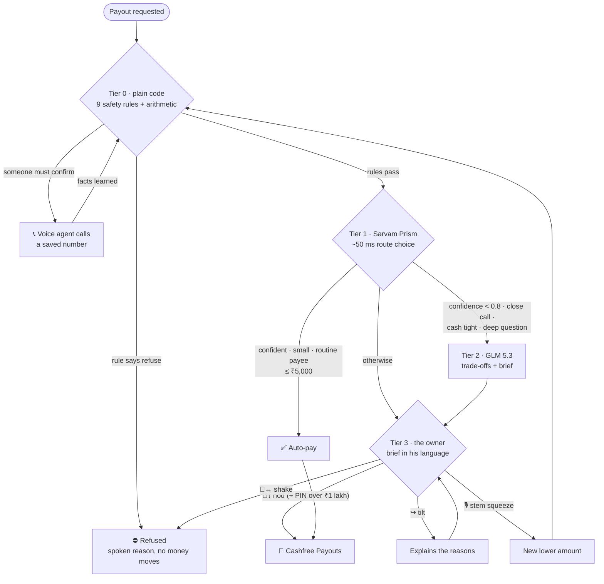
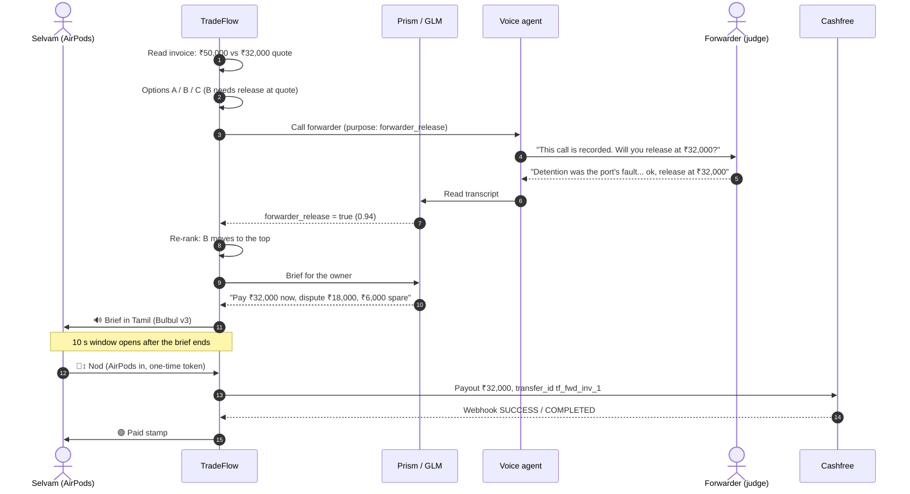
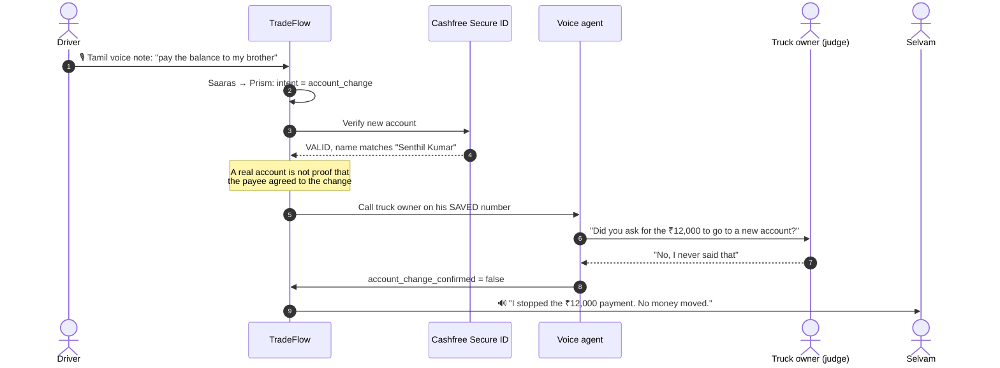
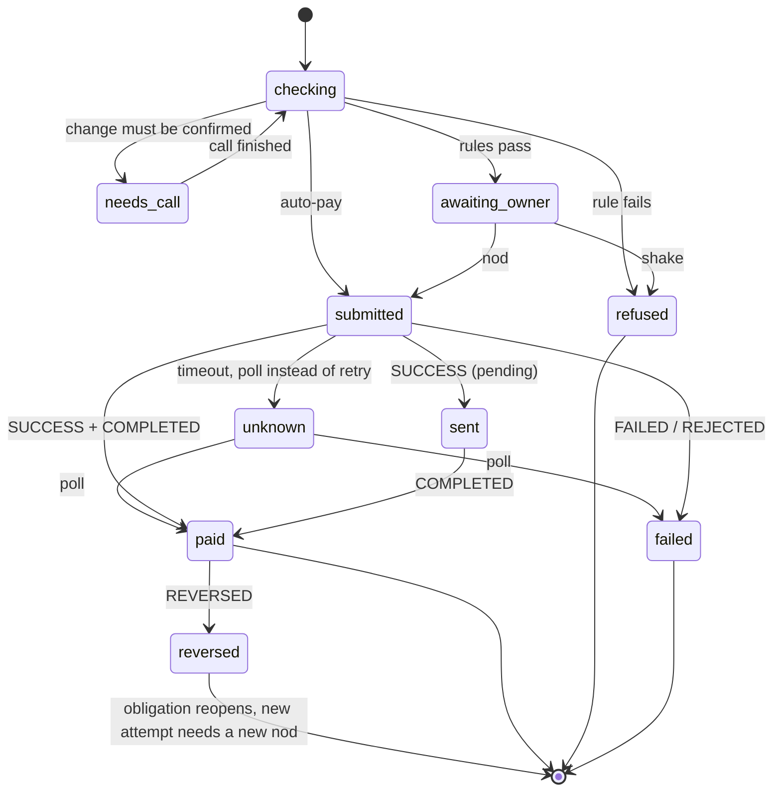
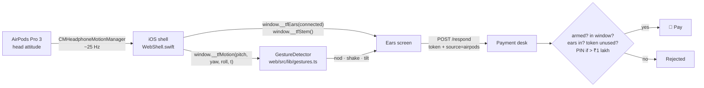
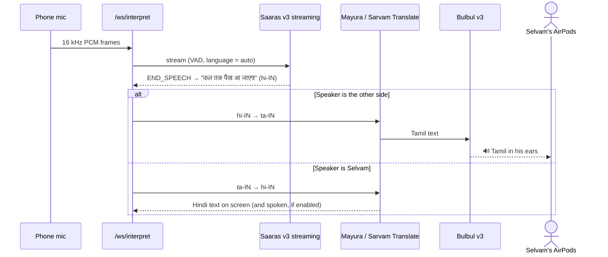

<div align="center">

# TradeFlow

### Approve a payment with a nod.

**A money control room for India's small exporters.** It reads the bill, phones the people involved in their own language, works out what's safe to pay, and whispers it in the owner's AirPods. A nod sends the money through Cashfree. A shake stops it.

`Sarvam Prism` · `GLM 5.3` · `Saaras v3` · `Bulbul v3` · `Cashfree Payouts` · `Secure ID` · `Payment Links` · `AirPods Pro 3`

</div>

---

## The problem

Selvam runs a garment export unit in Tiruppur. In one afternoon:

- the freight forwarder bills **₹50,000** against a **₹32,000** quote, and won't release the cargo until it's paid,
- a yarn supplier is due **₹1,80,000** tomorrow,
- a buyer owes **₹2,50,000** but has paid late twice in five orders,
- and the truck driver sends a voice note asking for the balance to go to *his brother's* account.

Each decision needs a phone call, some arithmetic and a judgement call, usually on the road, in Tamil, with no laptop. Get one wrong and the cargo misses the vessel or the money goes to a fraudster.

## What TradeFlow does

| | |
| --- | --- |
| 🧾 **Reads the bill** | Sarvam Vision pulls the line items. Code spots ₹18,000 of detention above the quote. |
| 📞 **Makes the call** | A voice agent rings the forwarder in Tamil, Hindi or English and asks whether he'll release at the quoted ₹32,000. |
| 🧮 **Does the maths** | Plain code builds options A/B/C and ranks them on cash left, risk and deadlines. No model does arithmetic. |
| 🎧 **Briefs the owner** | GLM 5.3 writes a two-line brief, Bulbul speaks it in Tamil in his AirPods. |
| 🙂‍↕️ **Waits for a nod** | Nod = pay. Shake = stop. Tilt right = "why?". Squeeze the stem = "make it ₹25,000". |
| 💸 **Pays and confirms** | Cashfree Payouts sends it; only Cashfree's webhook marks it paid. |
| 🛡️ **Catches the trap** | The bank says the brother's account is real. That isn't proof, so TradeFlow calls the truck owner on his saved number, and refuses when he denies it. |
| 🌐 **Translates live** | A two-way interpreter: the other side speaks Hindi, Selvam hears Tamil in his ears. |

> **The rule that shapes everything:** models can *check, look up, explain and collect*. Only code plus the owner's nod can move money out. ([ADR 0001](docs/adr/0001-no-model-moves-money.md))

---

## Architecture



The Next.js PWA is a static export served by FastAPI, so **one HTTPS tunnel covers the page, the API, the voice WebSockets and the Cashfree webhooks** ([ADR 0003](docs/adr/0003-static-export-served-by-fastapi.md)). The iPhone app is a thin shell that adds what browsers can't do: read AirPods head motion ([ADR 0002](docs/adr/0002-ios-shell-for-head-motion.md)).

### The decision tiers

Every payout climbs only as far up the ladder as it needs to.



The Tier 0 rules: `amount_within_outstanding`, `no_payout_in_flight`, `not_duplicate`, `totals_add_up`, `extraction_confident`, `payee_verified`, `account_change_confirmed`, `new_account_verified`, `cash_available`. If Prism and GLM disagree, the case goes to the owner and the disagreement is written to the audit trail.

---

## The hero flow

The ₹18,000 freight dispute, start to finish:



### The trap



### Payout lifecycle

A payout's status is changed **only** by Cashfree (webhook or status poll), never by a model.



Each obligation attempt has one fixed `transfer_id` (`tf_{obligation}_{attempt}`), so a retry can never pay twice.

---

## AirPods gestures



| Gesture | Means | How it's detected |
| --- | --- | --- |
| 🙂‍↕️ Nod | Approve | Pitch swings down and back past an adaptive baseline |
| 🙂‍↔️ Shake | Refuse | Yaw swings left/right/left (wrap-safe) |
| ↪️ Tilt right | "Why?" | Roll held past threshold |
| 👆 Stem squeeze | Speak a new amount | Play/pause remote command |

The detector is plain TypeScript with unit tests, so the browser fallback (keys **N** / **S** / **T** / **M**) runs exactly the same code as the AirPods.

## Live translation



The language is detected per sentence, so nobody presses a button to say whose turn it is.

---

## Screens

| Route | Who | What |
| --- | --- | --- |
| `/` **Room** | Laptop | Spendable cash (confirmed / pending / estimated, never mixed), the demo script as a stepper, options A/B/C, payouts with stamps, live audit feed |
| `/ears` **Ears** | Owner's iPhone | Brief playback, 10 s countdown ring, a head that mirrors yours, gesture legend |
| `/phone?as=…` **Phone** | Judge's phone | Rings when TradeFlow calls `forwarder`, `truck_owner` or `buyer`; talk to the voice agent |
| `/translate` **Translate** | Owner's iPhone | Two-way live interpreter |
| `/trail?id=…` **Why?** | Anyone | Every rule, model answer, call line and Cashfree status behind one payout |
| `/scorecard` **Traps** | Anyone | 13 planted traps + 3 good payments through the rules |

## Models

All on one Sarvam key.

| Job | Model | Latency (measured) |
| --- | --- | --- |
| Yes/no, choice, score, routing | `sarvam-prism` (`POST /v2/systemone`) | 50–150 ms |
| Trade-offs and the brief | `glm5.3`, backup `deepseekv4.1-flash-1017` | 1–3 s |
| Voice agent turns | `sarvam-105b-conversations` | ~0.4 s |
| Speech to text | `saaras:v3` streaming, VAD, auto language | ~0.2 s after speech ends |
| Text to speech | `bulbul:v3` | ~1.2 s |
| Translation | `mayura:v1` code-mixed, `sarvam-translate:v1` fallback | <1 s |
| Invoices | Sarvam Vision Doc AI | async job |

## Cashfree

| Product | Used for |
| --- | --- |
| **Secure ID** · Bank Account Verification V2 | Every payee, and every changed account |
| **Payouts V2** · beneficiary + transfer (`2024-01-01`) | Truck, forwarder and supplier payouts with fixed `transfer_id` |
| **Payment Links** (`2025-01-01`, partial payments) | Buyer pays during the voice call |
| **Webhooks** · HMAC-SHA256 verified | The only source of truth for payout and link status |

Paid means `SUCCESS` + `COMPLETED` (or `ACKNOWLEDGED`). `REVERSED` reopens the obligation and needs a fresh approval. A timeout is polled, never retried.

**No keys? It still runs.** `SimRails` emits the same webhook payloads Cashfree sends and uses Cashfree's published sandbox test accounts. Simulated money is always labelled *simulated* in the UI.

<details>
<summary><b>Keys for the live Cashfree sandbox</b></summary>

From the [Merchant Dashboard](https://merchant.cashfree.com) in **Test** mode:

1. **Payouts** → Developers → API Keys → client ID + secret. Then Two-Factor Authentication: whitelist your IP, **or** download the public key and set `CASHFREE_PAYOUTS_PUBLIC_KEY_PATH` (we sign `X-Cf-Signature` for you).
2. **Secure ID** → Developers → API Keys (Bank Account Verification enabled).
3. **Payment Gateway** → Developers → API Keys (for Payment Links).
4. **Webhooks**: Payouts → Developers → Webhooks → `https://<tunnel>/webhooks/cashfree/payouts`. Payment links notify `PUBLIC_URL/webhooks/cashfree/links` automatically.
5. Add test balance to the Payouts sandbox.

Put them in `backend/.env` (template: [`backend/.env.example`](backend/.env.example)).

</details>

---

## Run it

**You need:** Python 3.12 + [uv](https://docs.astral.sh/uv/), Node 20+, a Sarvam API key, and for gestures an iPhone with AirPods Pro / Max / 3rd gen or later.

```bash
# 1. Backend
cd backend
cp .env.example .env          # add SARVAM_API_KEY
uv sync
uv run pytest -q              # 12 tests
uv run tradeflow              # http://localhost:8000

# 2. Web app (built once, served by the backend)
cd ../web
npm install
NEXT_PUBLIC_API= npm run build
npx vitest run                # 6 gesture tests

# 3. HTTPS tunnel (the iPhone mic and Cashfree webhooks need HTTPS)
ngrok http 8000               # then set PUBLIC_URL in backend/.env and restart
```

Open `https://<tunnel>/` on the laptop and `https://<tunnel>/phone` on the judge's phone. For hot reload while developing: `cd web && npm run dev`.

### iPhone app

Needs a **real iPhone**: there is no head motion in the simulator.

```bash
brew install xcodegen
cd ios
# set DEVELOPMENT_TEAM in project.yml to your Apple team ID
xcodegen generate
open TradeFlowEars.xcodeproj  # choose your iPhone, press Run
```

<details>
<summary>Or from the terminal</summary>

```bash
xcrun devicectl list devices  # find your iPhone's UDID
xcodebuild -project TradeFlowEars.xcodeproj -scheme TradeFlowEars \
  -destination 'id=<UDID>' -derivedDataPath build -allowProvisioningUpdates build
xcrun devicectl device install app --device <UDID> \
  build/Build/Products/Debug-iphoneos/TradeFlowEars.app
```

</details>

First launch: trust the developer in **Settings → General → VPN & Device Management**, turn on Developer Mode if asked, then paste your tunnel URL. The app opens `/ears`; long-press to change the URL. A free Apple ID install lasts 7 days; to share with other iPhones, use TestFlight from a paid team.

No iPhone? The Ears screen works in any browser with on-screen buttons or keys **N** / **S** / **T** / **M**.

---

## Demo script (≈3 minutes)

1. **Room → Use sample invoice.** ₹50,000 against a ₹32,000 quote. Option A leaves you ₹12,000 short; B leaves ₹6,000 but needs the forwarder to agree; C keeps ₹38,000 but the cargo stays held.
2. **Ring forwarder.** The judge answers on `/phone?as=forwarder` and agrees to release at ₹32,000. Prism marks it; option B jumps to the top.
3. **Ears.** Selvam hears the brief in Tamil and nods. ₹32,000 is paid, the webhook confirms, the stamp turns green.
4. **Driver voice note.** "Pay my brother." Secure ID says the account is real; TradeFlow calls the truck owner anyway (`/phone?as=truck_owner`). He denies it. Refused, in Tamil. Nothing moves.
5. **Ring buyer.** The agent confirms the date and sends a Payment Link mid-call. Pay ₹1; cash updates live.
6. Tap **Why?** on any payout, then open **Traps**.

---

## Repo map

```
backend/            FastAPI + uv
  src/tradeflow/
    tier0.py        rules, cash position, options (no models)
    engine.py       Tier 0 → Prism → GLM routing
    payments.py     approvals, payouts, webhooks (the only place money moves)
    calls.py        voice agent calls → facts
    voice.py        streaming STT ↔ TTS loop over WebSocket
    rails.py        CashfreeRails / SimRails
    service.py      orchestrator
web/                Next.js 16 PWA (static export)
  src/lib/gestures.ts   head-gesture detector (+ tests)
ios/                TradeFlow Ears SwiftUI shell
docs/adr/           decisions
CONTEXT.md          domain glossary
```

## Honest limits

- The balance is a demo figure, labelled *simulated*, until live Payouts keys are added.
- Real outbound phone calls need a Sarvam Voice Agents deployment (`SARVAM_AGENTS_*`). Without it the judge talks to the agent in the browser.
- Gesture thresholds are tuned on synthetic data and a handful of real nods. The "tilt right" roll sign may need flipping for some wearers (`rollRightSign`).
- Port, customs and carrier events are simulated. No international payouts.

<div align="center"><sub>Built for the Sarvam × Cashfree hackathon.</sub></div>
